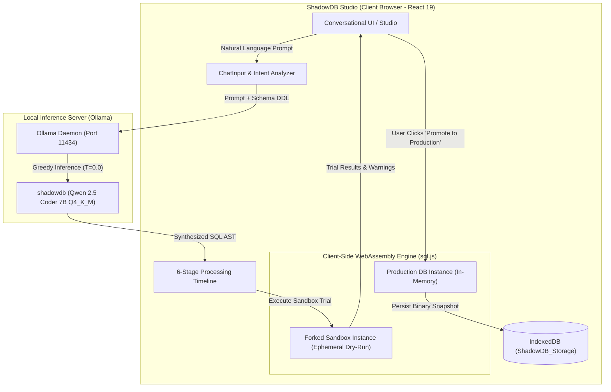
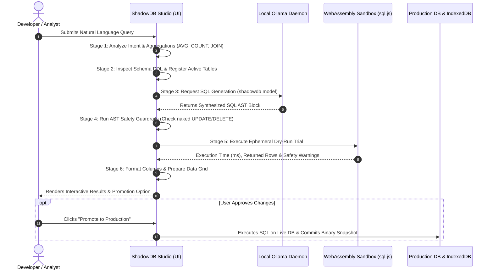
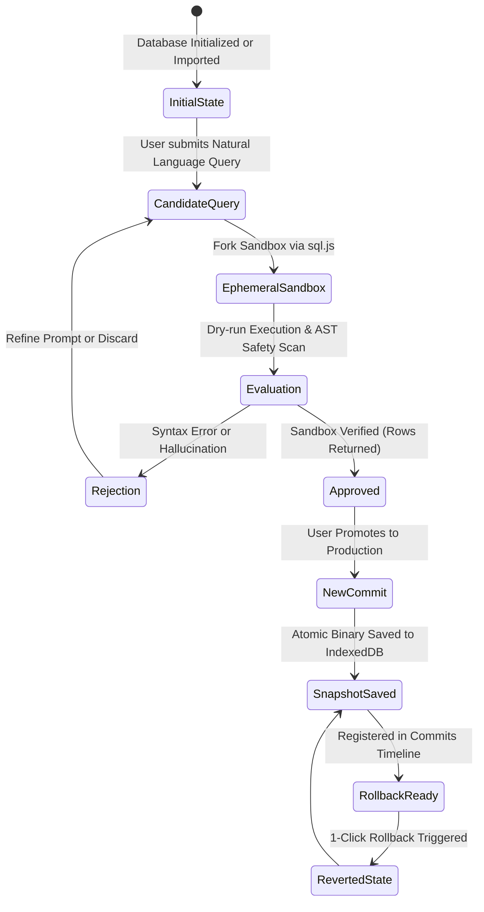

# 🛡️ ShadowDB

<div align="center">

**AI-Powered Natural Language Text-to-SQL Studio with Dual-Engine WebAssembly Sandboxing & Git-Style Database Version Control**

[](https://react.dev/)
[](https://vitejs.dev/)
[](https://sql.js.org/)
[](https://ollama.ai/)
[](https://huggingface.co/Qwen/Qwen2.5-Coder-7B-Instruct)
[](LICENSE)

[**Download Fine-Tuned GGUF Model (4.68 GB)**](https://drive.google.com/file/d/1GRxV7cIdVo3vaby-ZLVsBKwPBFMfKSPn/view?usp=sharing) • [**System & UI Report**](reports/SHADOWDB_SYSTEM_AND_UI_REPORT.md) • [**Training Report**](reports/SHADOWDB_TRAINING_REPORT.md) • [**Dataset EDA**](reports/dataset_EDA.md)

</div>

---

## ⚡ What is ShadowDB?

**ShadowDB** bridges the gap between Large Language Models and relational databases. Traditional text-to-SQL tools are fraught with risks: catastrophic data mutations (unfiltered `UPDATE`/`DELETE` or `DROP`), hallucinated schemas, and sensitive corporate data leaks to proprietary cloud APIs.

ShadowDB solves these vulnerabilities through a multi-tier paradigm:
1. **100% Local Inference:** Driven by a fine-tuned **Qwen 2.5 Coder 7B Instruct** model served locally via Ollama. No data ever leaves your machine.
2. **Dual-Engine In-Browser WebAssembly Sandboxing (`sql.js`):** Every AI-synthesized SQL query is dry-run inside an ephemeral, forked in-memory WebAssembly SQLite sandbox. Production data is completely isolated until you review and promote the change.
3. **AST Safety Guardrails:** Proactively detects and warns against destructive operations (naked `UPDATE` and `DELETE` queries lacking `WHERE` clauses).
4. **Git-Like Snapshotting & 1-Click Rollback:** Every approved transaction commits an immutable binary snapshot with a distinct commit hash, enabling instant, one-click state rollbacks.
5. **Modern Reactive Studio:** A rich developer studio built with React 19, TailwindCSS, ambient canvas particle systems, interactive schema inspectors, and dual `.sqlite` / `.sql` export engines.

---

## 🧠 Model Weights & Download

The specialized Text-to-SQL model is a fine-tuned version of **Qwen 2.5 Coder 7B Instruct** trained on 99,997 cleaned synthetic SQL schema pairs using 4-bit QLoRA and response-only loss masking.

* **Format:** GGUF `Q4_K_M` (4-bit medium quantization)
* **File Size:** 4.68 GB (`4,683,073,696` bytes)
* **Target Location:** `shadowdb_model/Qwen2.5-Coder-7B-Instruct.Q4_K_M.gguf`
* **Direct Google Drive Download:**  
  👉 **[Download Qwen2.5-Coder-7B-Instruct.Q4_K_M.gguf (Google Drive)](https://drive.google.com/file/d/1GRxV7cIdVo3vaby-ZLVsBKwPBFMfKSPn/view?usp=sharing)**

---

## 🏗️ System Architecture



---

## 🔄 6-Stage Execution Pipeline

Every natural-language query undergoes a transparent, verifiable 6-stage lifecycle with real-time microsecond telemetry:



---

## ⏪ Git-Style Database State & Rollback Engine



---

## 📊 Evaluation & Training Benchmark Results

ShadowDB's model was fine-tuned using Unsloth on Google Colab with 4-bit NF4 quantization and response-only loss masking over the Gretel synthetic Text-to-SQL dataset.

### 1. Convergence & Training Dynamics

| Metric | Recorded Value | Description |
| :--- | :--- | :--- |
| **Base Architecture** | `Qwen/Qwen2.5-Coder-7B-Instruct` | 7.65B parameter state-of-the-art coding model |
| **Fine-Tuning Method** | 4-bit QLoRA ($r=16, \alpha=16$) | Target modules: `q, k, v, o, gate, up, down_proj` |
| **Trainable Parameters** | 40,370,176 (0.527%) | Efficient parameter adaptation |
| **Initial Training Loss** | `0.5997` | High initial perplexity |
| **Final Training Loss** | `0.1729` | Smooth asymptotic convergence |
| **Best Validation Loss** | `0.1708` (Step 300) | Validated against holdout test split |
| **Validation Perplexity ($PPL$)**| **`1.1862`** | Near-deterministic SQL syntax token prediction |

### 2. SQLite Sandbox Execution Benchmarks ($N = 100$)

Evaluated on unseen schemas inside an isolated SQLite test sandbox:

| Dimension | Score | Significance |
| :--- | :--- | :--- |
| **AST Syntactic Validity Rate** | **80.0%** | Zero syntax errors; compiles into valid SQLite AST |
| **Schema Execution Grounding** | **80.0%** | Accurate column/table alignment without hallucinated identifiers |
| **Normalized Exact Match (EM)** | **27.0%** | Exact token-for-token equality with human-crafted ground truth |

### 3. SQL Clause Recall Analysis

| SQL Clause | Recall Accuracy | Status |
| :--- | :--- | :--- |
| `WHERE` | **98.7%** | 🟢 Exceptional filtering accuracy |
| `FROM` | **97.9%** | 🟢 Robust table resolution |
| `SELECT` | **97.7%** | 🟢 High-precision projection |
| `LIMIT` | **100.0%** | 🟢 Universal boundary protection |
| `ORDER BY` | **81.8%** | 🟢 Reliable sorting semantics |
| `GROUP BY` | **71.1%** | 🟡 Consistent analytical aggregation |
| `JOIN` | **60.0%** | 🟡 Solid relational mapping across multi-table foreign keys |
| `HAVING` | **40.0%** | 🟡 Complex conditional group filtering |

---

## 💻 Studio User Interface & Features

The web studio (`shadowdb-studio`) provides a unified developer workbench:

1. **Studio Tab (`Terminal`):**
   * Conversational natural language interface with schema-aware starter prompt chips.
   * Collapsible 6-stage execution pipeline timeline with microsecond duration reporting.
   * High-contrast SQL code display (`#0b1120`) with greedy decoding badge (`T=0.0 GREEDY`) and 1-click clipboard copy.
   * Interactive tabular results with alternating rows, column headers, and formatted `null` states.
   * **Promote to Production** action that transitions approved sandbox dry-runs into live transactions.

2. **Explore Tab (`Compass`):**
   * Context-aware prompt suggestions grouped by domain (Business Analytics, Sales & Revenue, Customer Insights, Trends, Advanced SQL).
   * 1-Click execution that automatically stages queries into the chat console.

3. **Explorer Tab (`Database`):**
   * Multi-database workspace manager with table search filters.
   * **Live Data View:** Scrollable data grid with in-table fuzzy row search.
   * **Schema DDL View:** Complete `CREATE TABLE` DDL with 1-click clipboard copy.
   * **Structure PRAGMA View:** Inspects column data types, primary keys, nullability constraints, and default values.

4. **Commits Tab (`GitCommit`):**
   * Chronological audit log of all applied database mutations.
   * HEAD indicator and applied SQL diff previews.
   * **1-Click Rollback:** Instant state reversion to any historical snapshot without reloading the page.

5. **Header & Context Controls:**
   * Dynamic theme toggling (Dark Cosmic Obsidian `#080c14` & Light Slate `#f0f4f9`).
   * Live Ollama server heartbeat indicator with automatic 15-second polling.
   * Dual export: `.sqlite` binary snapshot and ANSI `.sql` dump script (DDL + `INSERT INTO` statements).
   * Database file importer supporting `.sqlite`, `.db`, and `.sql` dumps.

---

## 🚀 Quickstart Guide

### 1. Prerequisites
* **Node.js** (v18.0 or newer) & `npm`
* **Python** (v3.10 or newer)
* **Ollama** installed on your system ([Download Ollama](https://ollama.ai/))

---

### 2. Set Up the Local AI Model
1. Download the fine-tuned model weights:
   * **[Download Qwen2.5-Coder-7B-Instruct.Q4_K_M.gguf (4.68 GB)](https://drive.google.com/file/d/1GRxV7cIdVo3vaby-ZLVsBKwPBFMfKSPn/view?usp=sharing)**
2. Place the downloaded `.gguf` file in `shadowdb_model/`:
   ```bash
   shadowdb_model/Qwen2.5-Coder-7B-Instruct.Q4_K_M.gguf
   ```
3. Register the model with Ollama:
   ```bash
   cd shadowdb_model
   ollama create shadowdb -f Modelfile
   ollama run shadowdb
   ```
4. Verify the model is running at `http://127.0.0.1:11434`.

---

### 3. Launch ShadowDB Studio Web App
```bash
# Navigate to the studio directory
cd shadowdb-studio

# Install frontend dependencies
npm install

# Start Vite development server
npm run dev
```
Open your browser at `http://localhost:5173/`.

---

### 4. Run the Sandbox Verification Suite
To verify the WebAssembly SQLite import, table generation, and export roundtrip without launching the UI:
```bash
cd shadowdb-studio
node verify_sandbox_export.js
```

---

## 📂 Repository Structure

```
shadow_db/
├── .gitignore                                 # Git ignore rules (excludes large binaries & venvs)
├── requirements.txt                           # Python dependencies & GGUF model download link
├── README.md                                  # Master repository documentation
│
├── reports/                                   # Analysis, benchmarks & UI reports
│   ├── SHADOWDB_SYSTEM_AND_UI_REPORT.md       # Comprehensive 42KB master technical report
│   ├── SHADOWDB_TRAINING_REPORT.md            # Fine-tuning convergence & sandbox benchmarks
│   ├── dataset_EDA.md                         # Exploratory data analysis on 100k Gretel dataset
│   ├── shadowdb_documentation.md              # Architectural & guardrail documentation
│   ├── training_dynamics.png                  # Loss curves & perplexity charts
│   ├── sql_benchmark_metrics.png              # AST validity & clause recall charts
│   ├── eda_overview_gretel.png                # Dataset token distributions
│   ├── wordclouds_gretel.png                  # SQL vocabulary wordcloud
│   └── training_telemetry.json                # Step-by-step training telemetry data
│
├── shadowdb_model/                            # Model configuration & weights target
│   └── Modelfile                              # Ollama serving configuration (T=0.0, system prompt)
│   # Note: Qwen2.5-Coder-7B-Instruct.Q4_K_M.gguf (4.68 GB) is excluded via .gitignore
│   # Download: https://drive.google.com/file/d/1GRxV7cIdVo3vaby-ZLVsBKwPBFMfKSPn/view?usp=sharing
│
└── shadowdb-studio/                           # React 19 + Vite Web Application
    ├── index.html                             # Studio HTML entrypoint
    ├── package.json                           # Dependencies & scripts
    ├── tailwind.config.js                     # Theme tokens & styling rules
    ├── verify_sandbox_export.js               # Node.js WASM verification script
    ├── public/
    │   ├── favicon.svg                        # Vector logo favicon
    │   └── test_inventory.sqlite              # Baseline SQLite testing database
    └── src/
        ├── main.jsx                           # Application bootstrap
        ├── App.jsx                            # Main studio state orchestrator
        ├── index.css                          # Design tokens & CSS variables
        ├── theme/                             # Theme provider & accent palettes
        ├── services/
        │   ├── sandbox.js                     # In-browser WebAssembly SQLite engine (sql.js)
        │   ├── dbStorage.js                   # In-browser IndexedDB persistence
        │   └── ollama.js                      # Local Ollama REST client
        ├── hooks/
        │   └── useDatabaseStudio.js           # Core database studio hook
        └── components/
            ├── Header.jsx                     # Top navigation, status & export controls
            ├── Sidebar.jsx                    # Left navigation sidebar
            ├── ChatInput.jsx                  # Auto-resizing prompt input console
            ├── ConversationView.jsx           # Conversational stream & execution cards
            ├── ProcessingTimeline.jsx         # 6-stage interactive timeline
            ├── ExploreSection.jsx             # Categorized prompt suggestions
            ├── ExplorerView.jsx               # Database, Table, DDL & Structure inspector
            ├── CommitsView.jsx                # Immutable snapshot commit timeline
            ├── ParticleField.jsx              # Ambient HTML5 interactive canvas
            ├── ShadowLogo.jsx                 # Custom SVG isometric brand emblem
            └── Modals/                        # Create, Add Table, Import, Delete, Rollback modals
```

---

## 📄 License & Attribution

This project is open-source and licensed under the [Apache 2.0 License](LICENSE).

Developed with ❤️ by Mohamed Arif J.
